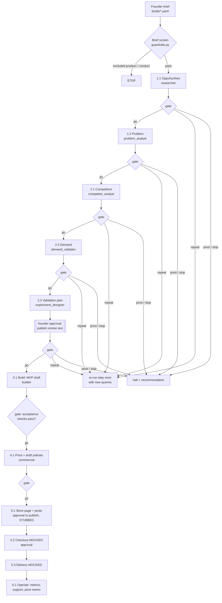
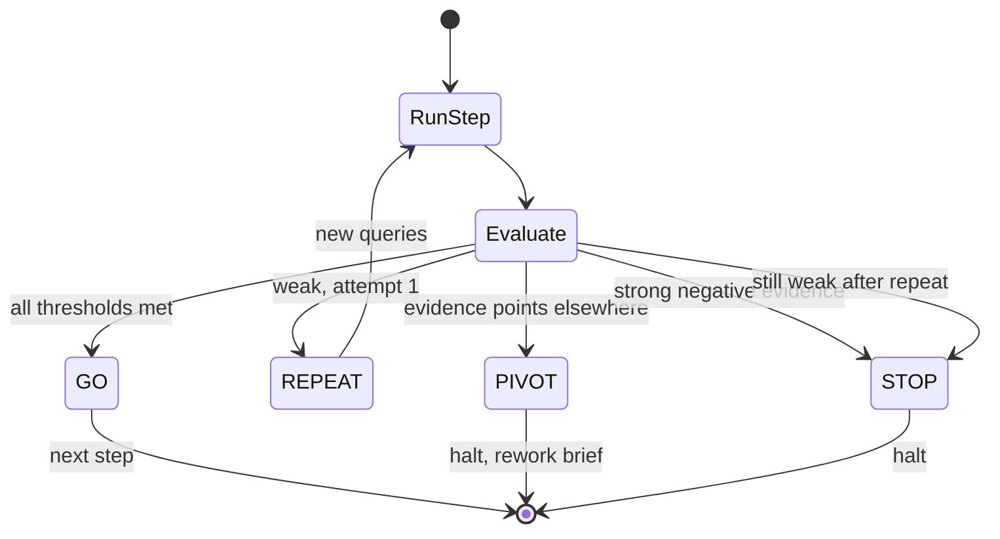
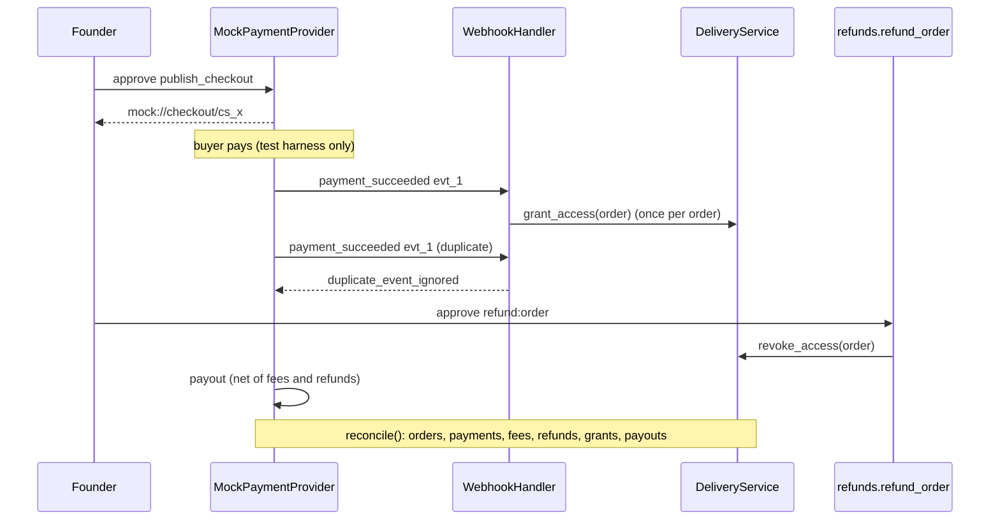
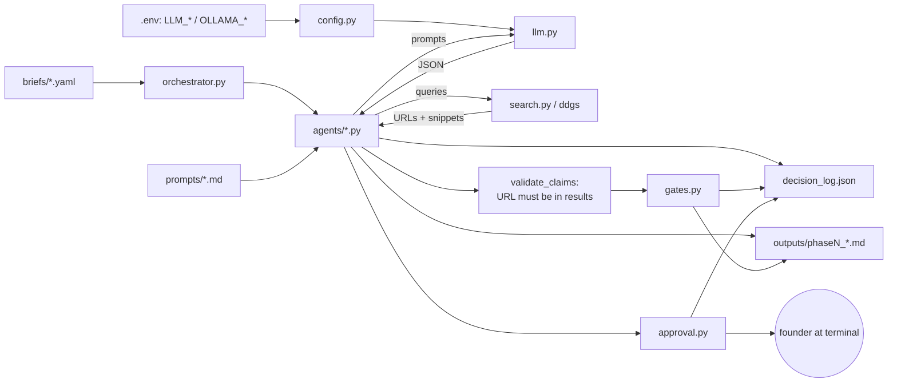

# Architecture

## Overview

`orchestrator.py` loads a founder brief (YAML or Markdown), screens it with `guardrails.py`, and then runs eleven steps across six phases. After every step, `gates.py` turns metrics computed in code into **go / repeat / pivot / stop**, and the run halts at the first gate that is not GO. Every phase has a real agent on an OpenAI-compatible LLM (OpenRouter `nvidia/nemotron-3-ultra-550b-a55b:free`, or local Ollama `gpt-oss:20b`); Phases 1 and 2 also use free web search through `ddgs`. Publishing is **STUBBED**, and payments and delivery are **MOCKED**, with no payment provider or sandbox of any kind. Every outward-facing action goes through `approval.py`. Every agent action is appended to `decision_log.json`, and every step and gate is written to `outputs/`.

Every gate (including the drafting and MOCKED gates after steps 3–6) writes `outputs/phase<N>_gate_<name>.md` and a `gate` entry in `decision_log.json`.

## Phases

### Phase 1: Discover (Working)

**Step 1.1, Opportunities.** Agent: `agents/researcher.py`, prompt `prompts/researcher.md`.
- *Tools:* LLM query planner (`prompts/query_planner.md`) and `search.WebSearch` (ddgs, no key).
- *Method:* the LLM writes 3–4 neutral and sceptical queries. Each query is searched, and the results are de-duplicated (up to 32). The LLM extracts up to 12 claims typed `pain`, `workaround`, `trend` or `other`, each with a `source_url`. `agents/common.validate_claims` keeps a URL **only if the search actually returned it**; any other URL becomes `ASSUMPTION` and is noted. Claims that break a conduct guardrail are dropped.
- *Output:* `outputs/phase1_step1_opportunities.md`, a claims table with sources and metrics (`sourced_claims`, `distinct_domains`, `assumption_ratio`, `pain`, ...).

**Step 1.2, Problem.** Agent: `agents/problem_analyst.py`.
- *Method:* no new search. The LLM writes a target customer and a problem statement that cite step 1.1 claim IDs, and lists open assumptions. The code keeps only claim IDs that exist, and counts only the sourced ones as support.
- *Output:* `outputs/phase1_step2_problem.md`. Every unsupported belief is listed as `ASSUMPTION:`.

### Phase 2: Validate (Working; publishing STUBBED)

**Step 2.1, Competitors.** Agent: `agents/competitor_analyst.py`.
- *Method:* the same search-and-extract loop. Claims are typed `competitor`, `free_alternative`, `price_point` or `other`. A **paid price point** counts only if the claim is sourced and a currency amount is visible in it.
- *Output:* `outputs/phase2_step1_competitors.md`.

**Step 2.2, Demand.** Agent: `agents/demand_validator.py`.
- *Method:* searches for evidence of paying or refusing to pay. Claims are typed `wtp_positive`, `wtp_negative`, `demand_signal` or `other`. The prompt says general interest is not willingness to pay. The code counts the distinct domains behind the positive signals.
- *Output:* `outputs/phase2_step2_demand.md`.

**Step 2.3, Validation plan.** Agent: `agents/experiment_designer.py`.
- *Method:* the LLM drafts a **Lean Canvas** (nine blocks, every one labelled an ASSUMPTION until tested), landing-page copy, an experiment and success criteria fixed before the test runs. The copy is screened with the stricter marketing rules: no testimonials, ratings, user counts, scarcity or income claims. Clean copy is shown to the founder with `approval.request_approval`. Only after `approve` does `publish_landing_page` run, and it is **STUBBED** (nothing goes online).
- *Output:* `outputs/phase2_step3_validation_plan.md`.

### Phase 3: Build (Working; shipping STUBBED)
**Step 3.1, Build the product.** Agent: `agents/builder.py`, prompt `prompts/builder.md`.
- *Method:* the LLM drafts the minimum digital product for the validated problem: a name, a format, 3–6 components with their full contents and the part of the problem each solves, a quick-start user guide, and acceptance tests a buyer can run. All text goes through the guardrails.
- *Tests:* `builder.run_checks` then tests the draft in code: at least 3 components, every component has contents and a purpose, the user guide names every component, at least 3 acceptance tests, and every test targets a component that exists. The gate is a **passing-tests gate**: any failed check gives REPEAT (the agent is told which checks failed), then STOP.
- *Output:* `outputs/phase3_step1_product_spec.md` (the MVP content, user guide, tests and check results). Uploading it to a host or store is **STUBBED**.

### Phase 4: Commercial setup (Working; no payments of any kind)
**Step 4.1, Set the price and policies.** Agent: `agents/commercial.py`, prompt `prompts/commercial.md`.
- *Method:* the LLM proposes one price from the MVP, the founder's budget and the **sourced** competitor prices from step 2.1. Any URL in its reasoning that the search did not return is replaced with `ASSUMPTION`, and with no sourced prices the whole rationale is labelled `ASSUMPTION`. It drafts terms of sale, a privacy policy and a refund policy, each marked as a draft for founder review and not legal advice.
- *Output:* `outputs/phase4_step1_offer.md`. No payment, sandbox or account is created.

### Phase 5: Launch: sell, deliver, get paid (drafting Working; publishing STUBBED; payments MOCKED)
**Step 5.1, Open the store.** `agents/commercial.listing`, prompt `prompts/listing.md`, drafts the store page (only components that exist, the step 4.1 price, how delivery works) and two launch posts for the founder to share under their own name. The stricter marketing rules apply: any testimonial, rating, user count, urgency or income claim means the copy is never offered for approval and the gate stops. Clean copy goes to the founder, and `publish_listing` (**STUBBED**) runs only after `approve`.

**Step 5.2, Checkout.** `agents/seller.py` creates a **MOCKED** checkout through `payments.MockPaymentProvider.create_checkout` at the step 4.1 price, which requires an approval for `publish_checkout:<product>`.

**Step 5.3, Deliver automatically.** Confirms that delivery is wired to payment webhooks. The pipeline never simulates sales; the full mocked flow runs in `payment_test.py` (see Sale to cash).

### Phase 6: Operate and learn (Working; live data STUBBED)
**Step 6.1.** `agents/operator.py`, prompt `prompts/operator.md`. The LLM receives the Phase 2 success criteria and every gate outcome of the run, and drafts the metrics to track, a support plan, a review cadence and a persevere-or-pivot memo that sets decision rules from the fixed criteria. No live data is connected, the output says so, and the memo reports no results.

## Gates

Thresholds live in `gates.THRESHOLDS`. They are fixed before any run and are read-only (`MappingProxyType`). Metrics are computed in code from validated claims, so the LLM cannot grade its own evidence. `MAX_REPEATS = 1`.

| Gate | GO when | REPEAT | PIVOT | STOP |
|---|---|---|---|---|
| Brief screen | no guardrail hit | — | — | excluded product or conduct rule hit |
| 1.1 Opportunities | ≥6 sourced claims, ≥3 domains, ≥3 pain signals, assumption ratio ≤0.4 | evidence too thin, first attempt | volume met but only 1–2 pain signals | volume met with 0 pain signals; or still thin after the repeat |
| 1.2 Problem | statement backed by ≥3 sourced claims, and no more open assumptions than sourced supporting claims | not met, first attempt | — | still not met after the repeat |
| 2.1 Competitors | ≥5 sourced claims, ≥3 domains, ≥1 sourced paid price point | not met, first attempt | — | ≥5 sourced free alternatives and 0 paid price points (saturated); or still thin after the repeat |
| 2.2 Demand | ≥3 sourced willingness-to-pay signals from ≥3 domains, and more positive than negative | not met, first attempt | — | ≥2 negative signals and ≥2× as many negative as positive; or still thin after the repeat |
| 2.3 Validation plan | 0 guardrail violations and founder approved | rejected or violation, first attempt | — | still rejected / violating after the repeat |
| 3.1 Build | MVP drafted, 0 guardrail violations, every acceptance check passes | not met, first attempt | — | still not met after the repeat |
| 4.1, 5.1, 6.1 (drafting) | artifact produced, 0 guardrail violations, plus founder approval where the step publishes | not met, first attempt | — | still not met after the repeat; or a guardrail-breaking store page |
| 5.2, 5.3 (MOCKED) | artifact produced, plus founder approval for the checkout | not met, first attempt | — | still not met after the repeat |

**Search outages are not verdicts.** If more than half of an evidence step's searches return nothing (the free search service is down or rate-limiting), its gate judges nothing: it repeats the step, and if search is still unavailable it halts with "search unavailable: re-run later", never PIVOT or a STOP on the idea. The search client also retries with growing pauses (`search.py`).

**Threshold change log.** On 2026-11-17, after a real run, the step 1.2 rule changed from "at most 4 open assumptions" to "no more open assumptions than sourced supporting claims". The good-idea brief had stopped with 7 sourced supporting claims because the model listed 5–6 assumptions. A cap on the count rewards hiding assumptions, and testing them is Phase 2's job: they now go to step 2.3 as hypotheses for the smoke test. No evidence threshold changed besides this one; the same day, the search-outage rule above was added after a run where 3 of 4 searches failed. The demo outputs of both sample briefs come from runs under the new rule.

**When the system recommends STOP on weak evidence:** any evidence gate that is still below its thresholds after one repeat recommends STOP, rather than going forward on hope. It also recommends STOP straight away on strong negative evidence: a market full of free substitutes with no sourced paid price, or sourced refusals to pay that outweigh the evidence of paying. A STOP writes the reasons, the metrics and the thresholds to `outputs/phase<N>_gate_<name>.md`.

## Sale to cash

All of this is **MOCKED** (`payments.py`, `delivery.py`, `refunds.py`, `reconcile.py`). No payment provider, sandbox or real money is involved. Run it with `python payment_test.py`, which writes `outputs/payment_test_log.md`.

- **Payment triggers delivery:** `WebhookHandler.handle` grants access only on `payment_succeeded`, and only for an order that is still `pending`.
- **Idempotency:** processed event IDs are stored, so a repeated event returns `duplicate_event_ignored`. `DeliveryService.grant_access` returns the existing grant for an order, so there is never a second delivery.
- **A refund revokes access:** `refund_order` needs a founder approval for `refund:<order_id>`. It marks the order and payment refunded and revokes the grant. The system never refunds by itself.
- **Reconciliation:** `reconcile()` checks every order against its payment (amount, and fee against the MOCKED fee schedule of 2.9% + $0.30). It checks that paid orders are delivered, refunded orders are revoked, nothing was delivered twice or without payment, and payouts equal gross − fees − refunds.
- No names, emails, passwords or card numbers are stored. Buyers are opaque references.

## Data flow

Each `decision_log.json` entry has `timestamp`, `agent`, `action`, `sources`, `model`, `cost` and `approved_by`, plus optional `outcome`, `tokens`, `query` and `detail`. `approved_by` is `"founder"` only when the founder typed `approve`. The log and `outputs/` are reset at the start of each run, so they always describe a single run.

## Built vs. stubbed

| Component | Status |
|---|---|
| Brief loader (YAML/Markdown), config, LLM client with Ollama fallback and auto-pull | Built |
| Web search (ddgs), claim validation, metrics | Built |
| Agents and prompts for all six phases | Built |
| Phase 3 acceptance checks (in code) | Built |
| Gates with fixed thresholds | Built |
| Founder approval (CLI), guardrails, decision log | Built |
| Publishing the landing page, store page and posts; shipping the MVP | STUBBED |
| Live sales and usage data for Phase 6 | STUBBED |
| Payments, delivery, refunds, payouts, reconciliation | MOCKED |

## Roadmap

1. Phase 3: export the drafted MVP straight into the target format (for example a Notion template file), still with founder review before anything is shared.
2. Keep payments MOCKED inside this system. A founder who wants to sell connects their own store account outside it; the system never holds, moves or refunds money.
3. More evidence sources (marketplace listings, trend data), with the same "URL must be retrieved" rule.
4. A small web UI for approvals as well as the CLI.
5. Calibrate gate thresholds against past runs, and publish the changes in `gates.py` with their reasons.
